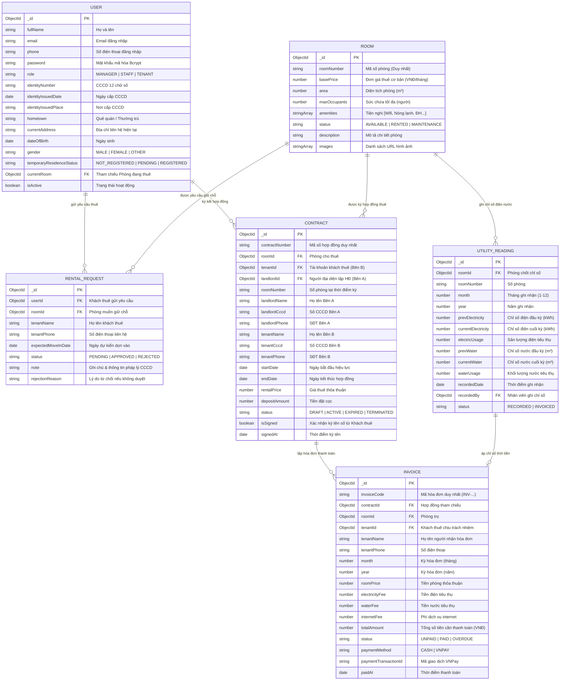

# SƠ ĐỒ THỰC THỂ CƠ SỞ DỮ LIỆU (DATABASE ERD)
## Hệ Thống Quản Lý Nhà Trọ & Căn Hộ Dịch Vụ (Motel Management System)

Sơ đồ quan hệ thực thể giữa các Collection trong cơ sở dữ liệu MongoDB theo kiến trúc Mongoose ODM.

