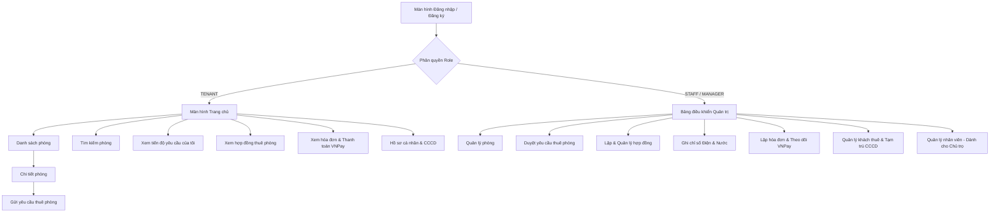

# BẢN THIẾT KẾ GIAO DIỆN MOCKUP (UI/UX DESIGN)
## Hệ Thống Quản Lý Nhà Trọ & Căn Hộ Dịch Vụ (Motel Management System)

Tài liệu thiết kế giao diện Mockup & Wireframe cho phân hệ Mobile App (React Native) và Web Management (React), phục vụ kiểm tra Giai đoạn 1 dự án SWD392.

---

### 1. Kiến Trúc Điều Hướng Mobile App (Site Map & Navigation Flow)



---

### 2. Thiết Kế Mockup Wireframe Các Màn Hình Chính

#### 2.1. Màn hình Trang Chủ (HomeScreen - Mobile)
```text
+---------------------------------------------------+
|  🏠 Motel Manager App               👤 [Tài khoản]|
+---------------------------------------------------+
|  [ Banner Quản Lý Nhà Trọ & Căn Hộ Dịch Vụ ]      |
|  +----------------+ +---------------+ +---------+ |
|  | Còn trống: 6   | | Đang thuê: 12 | | Bảo trì | |
|  +----------------+ +---------------+ +---------+ |
+---------------------------------------------------+
|  CHỨC NĂNG CHÍNH:                                 |
|  [🛏️ Xem phòng] [🔍 Tìm phòng] [📋 Thuê] [⚙️ QL]   |
+---------------------------------------------------+
|  PHÒNG NỔI BẬT:                                   |
|  +----------------------------------------------+ |
|  | Phòng 101                     3.200.000 đ    | |
|  | 📐 25m² • 👥 Tối đa 2 người                  | |
|  | [Wifi] [Điều hòa] [Nóng lạnh]                | |
|  +----------------------------------------------+ |
|  | Phòng 102                     2.800.000 đ    | |
|  | 📐 20m² • 👥 Tối đa 2 người                  | |
|  | [Wifi] [Nóng lạnh]                           | |
|  +----------------------------------------------+ |
+---------------------------------------------------+
```

#### 2.2. Màn hình Chi Tiết Phòng & Đặt Thuê (RoomDetailScreen)
```text
+---------------------------------------------------+
|  ‹ Quay lại danh sách phòng                       |
+---------------------------------------------------+
|  Phòng 201                        🟢 CÒN TRỐNG    |
|  Đơn giá: 3.500.000 đ/tháng                       |
+---------------------------------------------------+
|  THÔNG SỐ KỸ THUẬT:                               |
|  • Diện tích: 28 m²                               |
|  • Sức chứa: 2 người                              |
|  • Tiện nghi: Wifi tốc độ cao, Điều hòa Inverter, |
|               Bình nóng lạnh, Tủ lạnh riêng       |
|  • Mô tả: Phòng khép kín, ban công đón nắng, giờ  |
|           giấc tự do, camera an ninh 24/7.        |
+---------------------------------------------------+
|  [ 📋 GỬI YÊU CẦU THUÊ PHÒNG (REQUEST RENTAL) ]   |
+---------------------------------------------------+
```

#### 2.3. Màn hình Quản Lý Hợp Đồng (ManageContractScreen)
```text
+---------------------------------------------------+
|  📄 Quản Lý Hợp Đồng Thuê                         |
+---------------------------------------------------+
|  BÊN A (CHỦ TRỌ / ĐẠI DIỆN):                      |
|  • Họ tên: Nguyễn Quản Lý     • SĐT: 0901234567   |
|  • Số CCCD: 001201012345 (12 số chuẩn)           |
|                                                   |
|  BÊN B (KHÁCH THUÊ):                              |
|  • Họ tên: Phạm Văn Khánh     • SĐT: 0912345678   |
|  • Số CCCD: 038202009876 (12 số chuẩn)           |
|                                                   |
|  ĐIỀU KHOẢN HỢP ĐỒNG:                             |
|  • Phòng số: 101       • Tiền cọc: 3.200.000 đ    |
|  • Thời hạn: 01/11/2026 -> 01/05/2027 (6 tháng)   |
|  • Chữ ký số khách thuê: [✅ ĐÃ KÝ ONLINE]         |
+---------------------------------------------------+
|  [✍️ LẬP HỢP ĐỒNG]  [🔄 GIA HẠN]  [🛑 THANH LÝ]   |
+---------------------------------------------------+
```

#### 2.4. Màn hình Hóa Đơn & Thanh Toán VNPay (InvoicePaymentScreen)
```text
+---------------------------------------------------+
|  🧾 Chi Tiết Hóa Đơn Dịch Vụ - Tháng 11/2026      |
|  Mã hóa đơn: INV-P101-202611                      |
+---------------------------------------------------+
|  • Tiền phòng cơ bản:             3.200.000 đ     |
|  • Tiền điện (35 kWh x 3.500đ):     122.500 đ     |
|  • Tiền nước (4 m³ x 25.000đ):      100.000 đ     |
|  • Phí dịch vụ Internet / Rác:       80.000 đ     |
|  ------------------------------------------------ |
|  TỔNG CỘNG:                       3.502.500 đ     |
|  Trạng thái: 🟡 CHƯA THANH TOÁN                   |
+---------------------------------------------------+
|  PHƯƠNG THỨC THANH TOÁN:                          |
|  [ 🌐 Cổng thanh toán VNPay (QR / Thẻ ATM) ]      |
|  [ 💵 Thu tiền mặt trực tiếp ]                    |
+---------------------------------------------------+
```

---

### 3. Phân Công Trách Nhiệm Thiết Kế Giao Diện Theo Thành Viên
1. **Thành viên 1 - Quang:** Giao diện Quản lý phòng trọ (HomeScreen, RoomListScreen, RoomDetailScreen, RoomSearchScreen, ManageRoomScreen).
2. **Thành viên 2 - Khánh:** Giao diện Xác thực & Hồ sơ khách thuê (LoginScreen, RegisterScreen, ProfileScreen, TenantManagementScreen, StaffManagementScreen).
3. **Thành viên 3 - Đức:** Giao diện Yêu cầu đặt phòng & Quản lý hợp đồng (RentalRequestScreen, MyRentalRequestScreen, RequestManagementScreen, ContractListScreen, ContractDetailScreen, ManageContractScreen).
4. **Thành viên 4 - Mạnh:** Giao diện Điện nước, Hóa đơn & VNPay (UtilityScreen, InvoiceListScreen, InvoiceDetailScreen, PaymentScreen, PaymentHistoryScreen).
