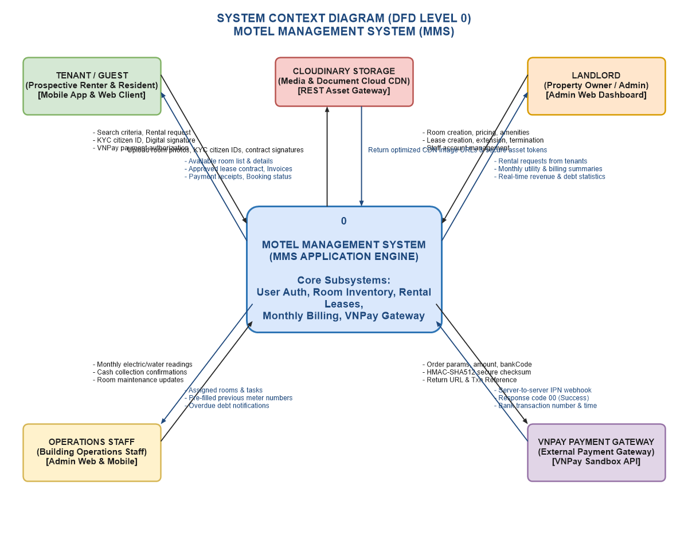
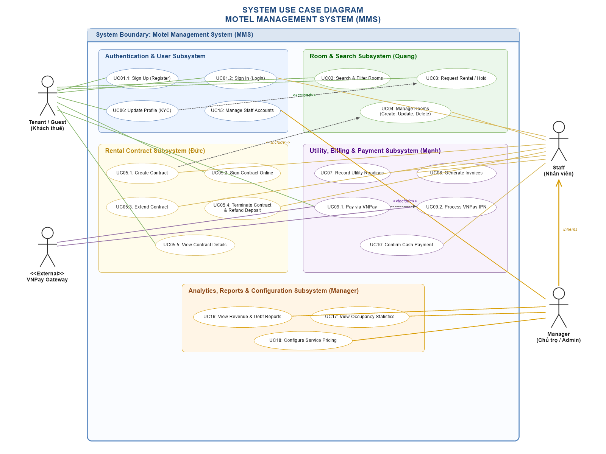
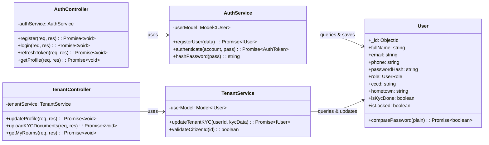
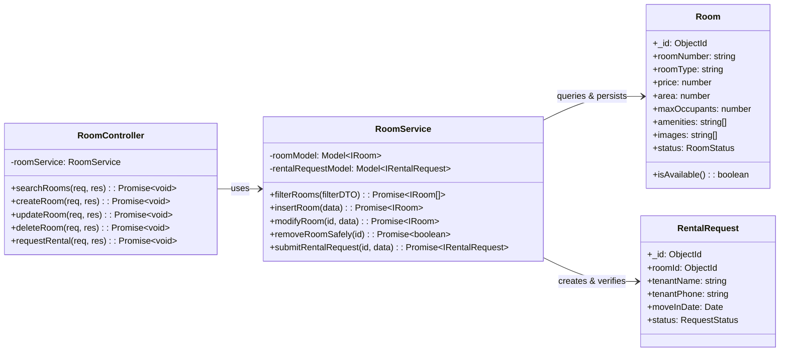
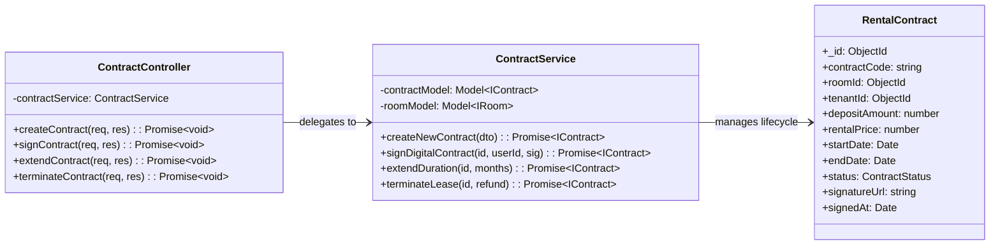
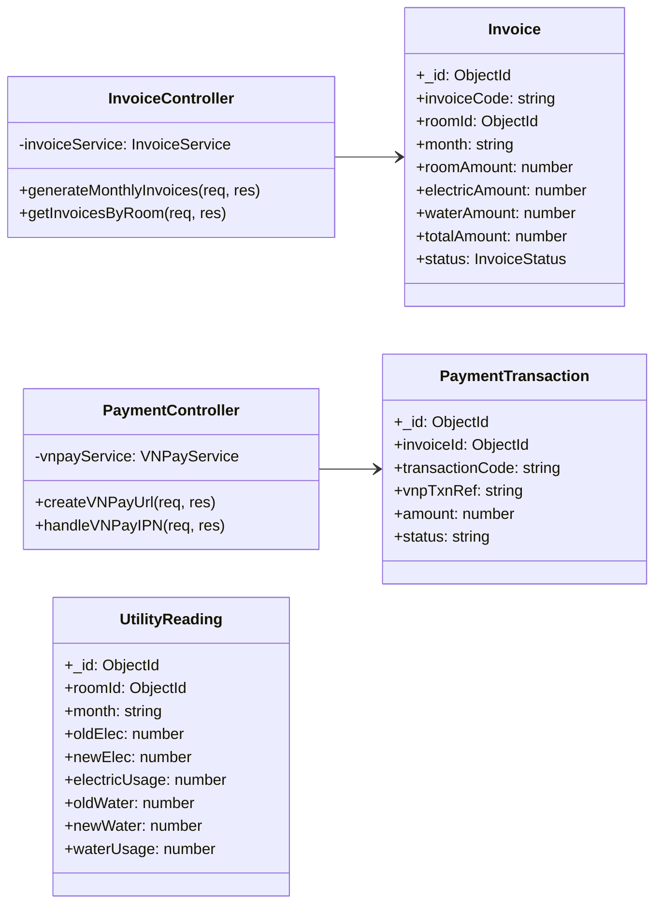

# CAPSTONE PROJECT REPORT - SWD392
# Report 4: Software Design Document (SDD)

**Course:** Software Design (SWD392) / Capstone Project  
**Institution:** FPT University  
**Project Title:** Motel Management System (MMS)  
**Academic Year:** 2026  
**Document Version:** 1.0.0  

---

## Team Members & Responsibilities

| No | Full Name | Student ID | Module / Role | Primary Responsibilities |
| :---: | :--- | :---: | :--- | :--- |
| **1** | **Leader Quang** | *Lead* | **Room & Search Management** | Architecture, Room CRUD, Room Search/Filter, Rental Request, draw.io UML pipelines |
| **2** | **Phạm Văn Khánh** | *Member* | **User & Tenant Management** | Authentication (JWT, Bcrypt), User Registration, Tenant KYC Profile, Staff Management |
| **3** | **Đức** | *Member* | **Rental Contract Management** | Contract Generation, Digital Signature, Contract Extension, Contract Termination |
| **4** | **Nguyễn Văn Mạnh** | *Member* | **Utility, Billing & Payment** | Meter Readings (Elec/Water), Invoice Generation, VNPay Payment Gateway & Webhook IPN |

---

## I. Record of Changes

| Date | Version | Description | Author | Approved By |
| :--- | :---: | :--- | :--- | :--- |
| 2026-10-25 | 0.1 | Initial System Architecture and Use Case Design | Leader Quang | Team |
| 2026-10-31 | 0.5 | Domain Class Diagram, ERD and Database Schemas design | Team | Mentor |
| 2026-11-04 | 0.8 | Complete Module-level API implementation & Sequence drafts | All Members | Instructor |
| 2026-11-10 | 1.0 | Full SDD assembly: Architecture, Package Diagrams, Module Class Diagrams, and 14 Sequence Diagrams | Leader Quang | Instructor |
| 2026-11-13 | 1.2 | Integrated Context Diagram and UML System Use Case Diagram with 17 Sequence Diagrams | Leader Quang | Instructor |

---

## Table of Contents
1. [1. System Design](#1-system-design)  
   1.0 [System Context Diagram (DFD Level 0)](#10-system-context-diagram-dfd-level-0)  
   1.0.1 [System Use Case Diagram (UML Use Case Model)](#101-system-use-case-diagram-uml-use-case-model)  
   1.1 [System Architecture](#11-system-architecture)  
   &nbsp;&nbsp;&nbsp;&nbsp;1.1.1 [Front-end Architecture](#111-front-end-architecture)  
   &nbsp;&nbsp;&nbsp;&nbsp;1.1.2 [Back-end Architecture](#112-back-end-architecture)  
   1.2 [Package Diagram](#12-package-diagram)  
   &nbsp;&nbsp;&nbsp;&nbsp;1.2.1 [Front-end Package Diagram](#121-front-end-package-diagram)  
   &nbsp;&nbsp;&nbsp;&nbsp;1.2.2 [Back-end Package Diagram](#122-back-end-package-diagram)  
2. [2. Detailed Design](#2-detailed-design)  
   2.1 [Module 1: Authentication & Tenant Management (Khánh)](#21-module-1-authentication--tenant-management-khánh)  
   &nbsp;&nbsp;&nbsp;&nbsp;2.1.1 [Class Diagram](#211-class-diagram)  
   &nbsp;&nbsp;&nbsp;&nbsp;2.1.2 [Sign Up (Register) Sequence Diagram](#212-sign-up-register-sequence-diagram)  
   &nbsp;&nbsp;&nbsp;&nbsp;2.1.3 [Sign In (Login) Sequence Diagram](#213-sign-in-login-sequence-diagram)  
   &nbsp;&nbsp;&nbsp;&nbsp;2.1.4 [Update Tenant Profile (KYC) Sequence Diagram](#214-update-tenant-profile-kyc-sequence-diagram)  
   &nbsp;&nbsp;&nbsp;&nbsp;2.1.5 [Manage Staff Accounts Sequence Diagram](#215-manage-staff-accounts-sequence-diagram)  
   2.2 [Module 2: Room & Search Management (Quang)](#22-module-2-room--search-management-quang)  
   &nbsp;&nbsp;&nbsp;&nbsp;2.2.1 [Class Diagram](#221-class-diagram)  
   &nbsp;&nbsp;&nbsp;&nbsp;2.2.2 [Search & Filter Rooms Sequence Diagram](#222-search--filter-rooms-sequence-diagram)  
   &nbsp;&nbsp;&nbsp;&nbsp;2.2.3 [Request Rental / Hold Room Sequence Diagram](#223-request-rental--hold-room-sequence-diagram)  
   &nbsp;&nbsp;&nbsp;&nbsp;2.2.4 [Create Room Sequence Diagram](#224-create-room-sequence-diagram)  
   &nbsp;&nbsp;&nbsp;&nbsp;2.2.5 [Update Room Info Sequence Diagram](#225-update-room-info-sequence-diagram)  
   &nbsp;&nbsp;&nbsp;&nbsp;2.2.6 [Delete Room Sequence Diagram](#226-delete-room-sequence-diagram)  
   2.3 [Module 3: Rental Contract Management (Đức)](#23-module-3-rental-contract-management-đức)  
   &nbsp;&nbsp;&nbsp;&nbsp;2.3.1 [Class Diagram](#231-class-diagram)  
   &nbsp;&nbsp;&nbsp;&nbsp;2.3.2 [Create Contract Sequence Diagram](#232-create-contract-sequence-diagram)  
   &nbsp;&nbsp;&nbsp;&nbsp;2.3.3 [Tenant Sign Contract Online Sequence Diagram](#233-tenant-sign-contract-online-sequence-diagram)  
   &nbsp;&nbsp;&nbsp;&nbsp;2.3.4 [Terminate Contract Sequence Diagram](#234-terminate-contract-sequence-diagram)  
   &nbsp;&nbsp;&nbsp;&nbsp;2.3.5 [Extend Contract Sequence Diagram](#235-extend-contract-sequence-diagram)  
   2.4 [Module 4: Utility, Invoice & VNPay Payment (Mạnh)](#24-module-4-utility-invoice--vnpay-payment-mạnh)  
   &nbsp;&nbsp;&nbsp;&nbsp;2.4.1 [Class Diagram](#241-class-diagram)  
   &nbsp;&nbsp;&nbsp;&nbsp;2.4.2 [Record Utility Readings Sequence Diagram](#242-record-utility-readings-sequence-diagram)  
   &nbsp;&nbsp;&nbsp;&nbsp;2.4.3 [Generate Monthly Invoices Sequence Diagram](#243-generate-monthly-invoices-sequence-diagram)  
   &nbsp;&nbsp;&nbsp;&nbsp;2.4.4 [Pay Invoice via VNPay Gateway Sequence Diagram](#244-pay-invoice-via-vnpay-gateway-sequence-diagram)  
   &nbsp;&nbsp;&nbsp;&nbsp;2.4.5 [VNPay IPN Callback & Webhook Sequence Diagram](#245-vnpay-ipn-callback--webhook-sequence-diagram)  
3. [3. Database Design](#3-database-design)  
   3.1 [System Domain Model / Class Diagram](#31-system-domain-model--class-diagram)  
   3.2 [Data Dictionary & Collection Schemas](#32-data-dictionary--collection-schemas)  

---

# 1. System Design

## 1.0 System Context Diagram (DFD Level 0)

The System Context Diagram (Context-level Data Flow Diagram - DFD Level 0) models the highest-level operational boundary of the Motel Management System (Process 0: Motel Management Systems). It visualizes all information flows exchanged between the core software engine and the four primary external entities (terminators): Tenant, Manager, Staff, and the external Payment Gateway.



### Inbound & Outbound Data Flows by Entity:
- **Tenant:**
  - *Inbound Flows:* Registration Information, Login Information, Room Search Criteria, Rental Request, Payment Request, Maintenance Request, Feedback / Complaint.
  - *Outbound Flows:* Contract, Invoice, Payment Result, Notifications, Room Information, Maintenance Status.
- **Staff:**
  - *Inbound Flows:* Maintenance Updates, Payment Confirmation, Tenant Information, Contract Information, Utility Readings.
  - *Outbound Flows:* Maintenance Requests, Payment Information, Invoice List, Contract Information, Tenant List, Room List, Room Information, Utility Reports.
- **Manager:**
  - *Inbound Flows:* Report Requests, Service Configuration, Pricing Configuration, Contract Management, Staff Management, Tenant Management.
  - *Outbound Flows:* Tenant Information, Revenue Reports, Payment Reports, Occupancy Reports, Maintenance Reports.
- **Payment Gateway (VNPay):**
  - *Outbound Flows (System to Gateway):* Payment Request, Invoice ID, Amount, Transaction Information.
  - *Inbound Flows (Gateway to System):* Payment Result, Transaction ID, Payment Status.

---

## 1.0.1 System Use Case Diagram (UML Use Case Model)

The System Use Case Diagram provides a comprehensive functional blueprint of the Motel Management System (MMS). It models the behavioral boundaries across five integrated subsystems: Authentication & User Management, Room Inventory & Rental, Rental Contract Management, Utility & Billing, and System Analytics. The diagram specifies all primary actor associations, inheritance hierarchies (Manager inherits all Staff capabilities), and inter-use-case dependencies (`<<include>>` and `<<extend>>`):



### Summary of Key Use Case Relationships:
- **Actor Inheritance:** Manager generalizes (inherits) Staff, granting property owners full operational permissions while adding exclusive analytical, reporting, and staff provisioning controls.
- **`<<include>>` Dependency (Lease):** Create Contract includes Manage Rooms to automatically synchronize room status to 'RENTED' upon lease execution.
- **`<<include>>` Dependency (Payment):** Pay Invoice via VNPay includes Process VNPay IPN to asynchronously verify merchant checksum and settle invoices upon banking confirmation.
- **`<<extend>>` Dependency (KYC):** Request Rental extends Update Profile (KYC), enabling pre-verified tenants with validated citizen ID credentials to book rooms with one-touch efficiency.

---

## 1.1 System Architecture

The Motel Management System is structured according to a modern **3-Tier Distributed Architecture**:

```
+-------------------------------------------------------------------------------+
|                       TIER 1: PRESENTATION LAYER (CLIENT)                     |
|  [React 18 Admin Web Dashboard]       [React Native / Expo Mobile App]        |
|  (Landlord & Operations Staff)         (Tenants, Guests & Renters)            |
+---------------------------------------+---------------------------------------+
                                        | HTTPS / REST APIs / JSON
                                        v
+-------------------------------------------------------------------------------+
|                   TIER 2: APPLICATION LAYER (BACKEND REST API)                |
|  +-------------------------------------------------------------------------+  |
|  |                 Express.js RESTful API Gateway & Middlewares            |  |
|  |                 (CORS, Helmet, RateLimit, JWT Guard, RBAC)              |  |
|  +-------------------------------------------------------------------------+  |
|  |  [User & Auth]    [Room & Search]    [Contract Module]    [Billing/VNPay]  |  |
|  |   Controllers       Controllers        Controllers          Controllers    |  |
|  |     Services          Services           Services             Services     |  |
|  |      Models            Models             Models               Models      |  |
|  +-------------------------------------------------------------------------+  |
+---------------------------------------+-----------------------+---------------+
                                        | Mongoose ODM          | SHA512 API
                                        v                       v
+---------------------------------------------------+   +-----------------------+
|             TIER 3: DATA STORAGE LAYER            |   |   EXTERNAL GATEWAYS   |
|   MongoDB Database Cluster (Replica Set)          |   |   VNPay Sandbox       |
|   (users, rooms, contracts, invoices, utilities)  |   |   (Payment Portal)    |
+---------------------------------------------------+   +-----------------------+
```

*Diagram File:* `docs/diagrams/System_Architecture.drawio`

### 1.1.1 Front-end Architecture
The client side contains two complementary platforms:
1. **Web Admin Dashboard (`frontend/`)**: Built with **React 18**, **Vite**, **Tailwind CSS**, and **Axios**. Used by Landlords and Staff to execute administrative workflows: room inventory CRUD, contract reviews, monthly utility metering, and revenue analytics.
2. **Mobile Application (`mobile/`)**: Developed with **React Native / Expo** for Android. Designed for Tenants and Prospective Renters: room search with filters, reservation requests, digital contract signing, invoice viewing, and one-touch VNPay payment.

### 1.1.2 Back-end Architecture
The back-end runs on **Node.js** with **Express.js**, enforcing a rigorous **Controller-Service-Repository/Model** pattern:
- **Routes Layer:** Declares RESTful endpoints, parameters, and binds role authentication guards.
- **Middlewares Layer:** Enforces JWT token validation, Role-Based Access Control (RBAC: `ADMIN`, `LANDLORD`, `STAFF`, `TENANT`), schema input validation, and centralized error handling.
- **Controllers Layer:** Unpacks HTTP requests, validates DTOs, delegates business logic to services, and packages JSON responses with unified status codes.
- **Services Layer:** Contains 100% of the domain business rules (room availability validation, password salting, signature verification, VNPay hash generation).
- **Models / ODM Layer:** Defines Mongoose schemas with indexed fields and automated pre-save business hooks.

---

## 1.2 Package Diagram

### 1.2.1 Front-end Package Diagram
```
frontend/src/
|-- assets/         # Static images, icons, and logo assets
|-- components/     # Reusable UI widgets (Modals, Tables, Cards, Inputs, Toasts)
|-- context/        # React Contexts (AuthContext, ThemeContext)
|-- hooks/          # Custom hooks (useAuth, useFetch, useDebounce)
|-- layouts/        # Page layouts (AdminLayout, TenantLayout, AuthLayout)
|-- pages/          # Primary view screens (Dashboard, Rooms, Contracts, Invoices)
|-- routes/         # Protected and public route declarations
|-- services/       # Axios API client instances mapped to backend endpoints
`-- utils/          # Formatting helpers (currencyVND, dateVN, validators)
```

### 1.2.2 Back-end Package Diagram
```
backend/
|-- config/         # Database connection, JWT constants, VNPay credentials
|-- controllers/    # auth.controller, room.controller, contract.controller, etc.
|-- middlewares/    # auth.middleware, roleGuard.middleware, errorHandler
|-- models/         # User.js, Room.js, RentalRequest.js, Contract.js, Invoice.js
|-- routes/         # auth.routes, room.routes, contract.routes, billing.routes
|-- services/       # auth.service, room.service, contract.service, vnpay.service
`-- utils/          # cryptoUtils, vnpayHash, responseFormatter
```

---

# 2. Detailed Design

## 2.1 Module 1: Authentication & Tenant Management (Khánh)

### 2.1.1 Class Diagram
*Diagram File:* `docs/diagrams/ClassDiagram_User_Module.drawio`  
The User & Tenant Module manages identity, JWT authentication, tenant KYC verification, and staff role assignment.



### 2.1.2 Sign Up (Register) Sequence Diagram
*Diagram File:* `docs/diagrams/UC-M01_1_Register_SequenceDiagram.drawio`  
- **Actor:** Tenant / Prospective Renter  
- **Trigger:** Submitting registration details on `RegisterScreen`.  
- **Business Rule:** Phone number and email must be unique across the entire database. Passwords are saved hashed with bcrypt (salt round = 10).

```
User -> RegisterScreen: fill name, phone, email, password
RegisterScreen -> auth.controller: POST /api/auth/register
auth.controller -> auth.service: registerUser(payload)
auth.service -> MongoDB: findOne({ $or: [{ phone }, { email }] })
alt [Existing user found]
    auth.service --> auth.controller: Error("Phone or email already registered")
    auth.controller --> RegisterScreen: 400 Bad Request
    RegisterScreen --> User: Show error alert
else [Credentials available]
    auth.service -> auth.service: bcrypt.hash(password, 10)
    auth.service -> MongoDB: insertOne(newUserDoc)
    auth.service -> auth.service: jwt.sign({ userId, role })
    auth.service --> auth.controller: { user, token }
    auth.controller --> RegisterScreen: 201 Created
    RegisterScreen --> User: Redirect to Home / Auto-login
end
```

### 2.1.3 Sign In (Login) Sequence Diagram
*Diagram File:* `docs/diagrams/UC-M01_2_Login_SequenceDiagram.drawio`  
- **Actor:** Any registered User (Tenant, Staff, Landlord).  
- **Trigger:** Submitting account identifier and password.  
- **Business Rule:** Verifies plain password against bcrypt hash; checks `isLocked === false`; returns JWT token.

### 2.1.4 Update Tenant Profile (KYC) Sequence Diagram
*Diagram File:* `docs/diagrams/UC-M06_Update_Tenant_Profile_SequenceDiagram.drawio`  
- **Actor:** Tenant.  
- **Trigger:** Tenant updates CCCD (12 numeric digits), hometown, and identity card photos.  
- **Business Rule:** Validates 12 numeric digits; upon success, sets `isKycDone: true`, enabling 1-click rental requests.

---

## 2.2 Module 2: Room & Search Management (Quang)

### 2.2.1 Class Diagram
*Diagram File:* `docs/diagrams/ClassDiagram_Room_Module.drawio`  
Manages room lifecycles, specifications, amenity tags, search/filter algorithms, and rental reservation requests.



### 2.2.2 Search & Filter Rooms Sequence Diagram
*Diagram File:* `docs/diagrams/UC-M02_Search_Room_SequenceDiagram.drawio`  
- **Actor:** Tenant / Guest.  
- **Trigger:** Entering keyword and adjusting price/area filters on `SearchRoomScreen`.  
- **Chronology:** Constructs MongoDB multi-criteria query (`$regex`, `$gte`, `$lte`), returns matched list, or renders Empty State if zero results.

### 2.2.3 Request Rental / Hold Room Sequence Diagram
*Diagram File:* `docs/diagrams/UC-M03_Request_Rental_SequenceDiagram.drawio`  
- **Actor:** Tenant.  
- **Trigger:** Clicking *"Request Rental / Giữ chỗ"* on Room Detail.  
- **Guards:** Checks room is `AVAILABLE`. Rejects if `RENTED` or `MAINTENANCE`. Creates `RentalRequest` record in `PENDING` status.

### 2.2.4 Create Room Sequence Diagram
*Diagram File:* `docs/diagrams/UC-M04_1_Create_Room_SequenceDiagram.drawio`  
- **Actor:** Landlord / Staff.  
- **Trigger:** Submitting *"Add New Room"* form.  
- **Validation:** Ensures `roomNumber` is unique and `price > 0`. Persists room in `AVAILABLE` status.

### 2.2.5 Update Room Info Sequence Diagram
*Diagram File:* `docs/diagrams/UC-M04_2_Update_Room_SequenceDiagram.drawio`  
- **Actor:** Landlord / Staff.  
- **Trigger:** Editing room price, description, images, or amenity tags. Matches teacher-approved UC-M09 specification.

### 2.2.6 Delete Room Sequence Diagram
*Diagram File:* `docs/diagrams/UC-M04_3_Delete_Room_SequenceDiagram.drawio`  
- **Actor:** Landlord.  
- **Critical Business Guard:** System queries `contracts` collection: if an active contract exists (`status === 'ACTIVE'`) or room is `RENTED`, deletion is blocked with `400 Bad Request` to preserve financial and audit integrity.

---

## 2.3 Module 3: Rental Contract Management (Đức)

### 2.3.1 Class Diagram
*Diagram File:* `docs/diagrams/ClassDiagram_Contract_Module.drawio`  
Governs legally binding leases, terms, digital signatures, monthly billing cycles, and deposit tracking.



### 2.3.2 Create Contract Sequence Diagram
*Diagram File:* `docs/diagrams/UC-M05_1_Create_Contract_SequenceDiagram.drawio`  
- **Actor:** Landlord / Staff.  
- **Trigger:** Approving a `RentalRequest` and generating lease.  
- **Flow:** Validates room status; creates contract in `DRAFT` / `PENDING_SIGN` state; switches room status to `RENTED`.

### 2.3.3 Tenant Sign Contract Online Sequence Diagram
*Diagram File:* `docs/diagrams/UC-M05_2_Sign_Contract_SequenceDiagram.drawio`  
- **Actor:** Tenant.  
- **Trigger:** Opening digital lease on Mobile App, drawing signature on Canvas, and confirming acceptance.  
- **Flow:** Validates `tenantId === loggedInUser`; saves electronic signature; activates contract (`ACTIVE`).

---

## 2.4 Module 4: Utility, Invoice & VNPay Payment (Mạnh)

### 2.4.1 Class Diagram
*Diagram File:* `docs/diagrams/ClassDiagram_Billing_Module.drawio`  
Covers monthly electricity/water metering, automatic invoice consolidation, and VNPay Payment Gateway integration.



### 2.4.2 Record Utility Readings Sequence Diagram
*Diagram File:* `docs/diagrams/UC-M07_Record_Utility_SequenceDiagram.drawio`  
- **Actor:** Staff / Landlord.  
- **Trigger:** Recording monthly meter indicators.  
- **Guard:** Requires `newElec >= oldElec` and `newWater >= oldWater`. Automatically calculates consumption.

### 2.4.3 Pay Invoice via VNPay Gateway Sequence Diagram
*Diagram File:* `docs/diagrams/UC-M09_1_VNPay_Payment_SequenceDiagram.drawio`  
- **Actor:** Tenant.  
- **Trigger:** Clicking *"Pay via VNPay"* for an unpaid invoice.  
- **Flow:** Backend verifies invoice is `UNPAID`; signs query parameters with `vnp_HashSecret` using HMAC-SHA512; returns Sandbox Payment URL to redirect user to VNPay.

### 2.4.4 VNPay IPN Callback & Webhook Sequence Diagram
*Diagram File:* `docs/diagrams/UC-M09_2_VNPay_IPN_Callback_SequenceDiagram.drawio`  
- **Actor:** External VNPay Server (Server-to-Server).  
- **Trigger:** Tenant completes bank transaction on VNPay.  
- **Flow:** VNPay sends asynchronous IPN request; backend verifies cryptographic checksum; inserts `PaymentTransaction` record; updates `Invoice.status = 'PAID'`; responds with `{ RspCode: '00', Message: 'Confirm Success' }`.

---

# 3. Database Design

## 3.1 System Domain Model / Class Diagram
*Diagram File:* `docs/diagrams/ClassDiagram_Full_Project.drawio`  
This domain diagram demonstrates the entity relationships, foreign key references, and multiplicity across all modules:
- 1 `User` (as Landlord) manages **1..*** `Room`.
- 1 `Room` can have **0..*** `RentalRequest` and **0..*** `RentalContract`.
- 1 `RentalContract` is associated with exactly **1** `Room` and **1** `User` (Tenant).
- 1 `Room` records **1..*** `UtilityReading` (one per month).
- 1 `RentalContract` produces **1..*** `Invoice` (monthly billing).
- 1 `Invoice` has **0..*** `PaymentTransaction`.

---

## 3.2 Data Dictionary & Collection Schemas

### 3.2.1 Collection: `users`
| Field Name | Data Type | Nullable | Key / Index | Description & Constraints |
| :--- | :---: | :---: | :---: | :--- |
| `_id` | ObjectId | No | PK | Unique identifier generated by MongoDB |
| `fullName` | String | No | - | User's legal full name |
| `email` | String | No | Unique Index | Valid email format, lowercase |
| `phone` | String | No | Unique Index | 10 numeric digits, login identifier |
| `passwordHash` | String | No | - | Bcrypt hash with salt rounds = 10 |
| `role` | String | No | - | Enum: `'ADMIN'`, `'LANDLORD'`, `'STAFF'`, `'TENANT'` |
| `cccd` | String | Yes | Index | 12 numeric digits citizen ID for KYC |
| `hometown` | String | Yes | - | Registered hometown from ID card |
| `cccdImages` | Array[String]| Yes | - | URLs of front and back ID card images |
| `isKycDone` | Boolean | No | - | Default `false`; `true` once verified |
| `isLocked` | Boolean | No | - | Default `false`; `true` disables sign-in |
| `createdAt` | Date | No | - | Timestamp of account creation |

### 3.2.2 Collection: `rooms`
| Field Name | Data Type | Nullable | Key / Index | Description & Constraints |
| :--- | :---: | :---: | :---: | :--- |
| `_id` | ObjectId | No | PK | Primary key |
| `roomNumber` | String | No | Unique Index | Room identifier (e.g., "P101", "P202") |
| `roomType` | String | No | Index | Enum: `'SINGLE'`, `'DOUBLE'`, `'STUDIO'`, `'MEZZANINE'` |
| `price` | Number | No | Index | Monthly rent in VND (min: 0) |
| `area` | Number | No | - | Room surface area in square meters ($m^2$) |
| `maxOccupants` | Number | No | - | Maximum permitted tenants (default: 2) |
| `amenities` | Array[String]| No | - | Tags: `['AC', 'HEATER', 'WIFI', 'BALCONY', 'KITCHEN']` |
| `images` | Array[String]| Yes | - | Cloudinary/S3 image URLs |
| `status` | String | No | Index | Enum: `'AVAILABLE'`, `'RENTED'`, `'MAINTENANCE'` |
| `description` | String | Yes | - | Detailed description and landlord notes |

### 3.2.3 Collection: `rental_requests`
| Field Name | Data Type | Nullable | Key / Index | Description & Constraints |
| :--- | :---: | :---: | :---: | :--- |
| `_id` | ObjectId | No | PK | Primary key |
| `roomId` | ObjectId | No | FK (rooms) | Target room requested |
| `tenantId` | ObjectId | Yes | FK (users) | Associated user account if logged in |
| `tenantName` | String | No | - | Full name of requester |
| `tenantPhone` | String | No | Index | Contact phone number |
| `moveInDate` | Date | No | - | Expected move-in date |
| `status` | String | No | Index | Enum: `'PENDING'`, `'APPROVED'`, `'REJECTED'`, `'CANCELLED'` |
| `note` | String | Yes | - | Special requests or occupancy notes |

### 3.2.4 Collection: `contracts`
| Field Name | Data Type | Nullable | Key / Index | Description & Constraints |
| :--- | :---: | :---: | :---: | :--- |
| `_id` | ObjectId | No | PK | Primary key |
| `contractCode` | String | No | Unique Index | Format: `HD-YYYY-XXXX` |
| `roomId` | ObjectId | No | FK (rooms) | Rented room identifier |
| `tenantId` | ObjectId | No | FK (users) | Primary tenant account |
| `landlordId` | ObjectId | No | FK (users) | Landlord executing contract |
| `rentalPrice` | Number | No | - | Agreed monthly rent in VND |
| `depositAmount`| Number | No | - | Deposit held in escrow (usually 1 month) |
| `startDate` | Date | No | - | Contract commencement date |
| `endDate` | Date | No | Index | Contract expiration date |
| `status` | String | No | Index | Enum: `'DRAFT'`, `'PENDING_SIGN'`, `'ACTIVE'`, `'EXPIRED'`, `'TERMINATED'` |
| `signatureUrl` | String | Yes | - | Stored digital signature canvas PNG |
| `signedAt` | Date | Yes | - | Timestamp when tenant signed online |

### 3.2.5 Collection: `utilities`
| Field Name | Data Type | Nullable | Key / Index | Description & Constraints |
| :--- | :---: | :---: | :---: | :--- |
| `_id` | ObjectId | No | PK | Primary key |
| `roomId` | ObjectId | No | FK (rooms) | Room measured |
| `month` | String | No | Compound Index | Billing cycle in `YYYY-MM` format |
| `oldElec` | Number | No | - | Previous electric meter indicator (kWh) |
| `newElec` | Number | No | - | Current electric meter indicator (kWh) |
| `electricUsage`| Number | No | - | Calculated: `newElec - oldElec` |
| `oldWater` | Number | No | - | Previous water meter indicator ($m^3$) |
| `newWater` | Number | No | - | Current water meter indicator ($m^3$) |
| `waterUsage` | Number | No | - | Calculated: `newWater - oldWater` |
| `readingDate` | Date | No | - | Date meter was inspected |

### 3.2.6 Collection: `invoices`
| Field Name | Data Type | Nullable | Key / Index | Description & Constraints |
| :--- | :---: | :---: | :---: | :--- |
| `_id` | ObjectId | No | PK | Primary key |
| `invoiceCode` | String | No | Unique Index | Format: `INV-YYYYMM-XXXX` |
| `contractId` | ObjectId | No | FK (contracts)| Associated lease contract |
| `roomId` | ObjectId | No | FK (rooms) | Associated room |
| `month` | String | No | Index | Billing cycle (`YYYY-MM`) |
| `roomAmount` | Number | No | - | Base room rent for the month |
| `electricAmount`| Number | No | - | Calculated: `electricUsage * electricUnitPrice` |
| `waterAmount` | Number | No | - | Calculated: `waterUsage * waterUnitPrice` |
| `internetFee` | Number | No | - | Fixed monthly high-speed WiFi fee |
| `garbageFee` | Number | No | - | Fixed environmental/sanitation fee |
| `totalAmount` | Number | No | - | Total payable sum in VND |
| `status` | String | No | Index | Enum: `'UNPAID'`, `'PAID'`, `'OVERDUE'` |
| `dueDate` | Date | No | - | Payment deadline (e.g., 5th of each month) |
| `paidAt` | Date | Yes | - | Timestamp payment was confirmed |

### 3.2.7 Collection: `payment_transactions`
| Field Name | Data Type | Nullable | Key / Index | Description & Constraints |
| :--- | :---: | :---: | :---: | :--- |
| `_id` | ObjectId | No | PK | Primary key |
| `invoiceId` | ObjectId | No | FK (invoices) | Invoice being settled |
| `transactionCode`| String | No | Unique Index | MMS internal transaction ID |
| `paymentMethod`| String | No | - | Enum: `'VNPAY'`, `'CASH'`, `'BANK_TRANSFER'` |
| `amount` | Number | No | - | Transaction amount in VND |
| `vnpTxnRef` | String | Yes | Index | VNPay unique transaction reference |
| `vnpTransactionNo`| String | Yes | - | Transaction code returned by VNPay banking portal |
| `bankCode` | String | Yes | - | Bank used (e.g., `'NCB'`, `'VCB'`, `'TCB'`) |
| `status` | String | No | Index | Enum: `'SUCCESS'`, `'FAILED'`, `'PENDING'` |
| `paidAt` | Date | No | - | Settlement timestamp |

---

# 4. Summary & Verification

All architectural models, package diagrams, module class diagrams, and sequence diagrams in this document have been synchronized and generated directly as visual **draw.io / Visual Paradigm** diagram files. 

### Location of Generated Diagrams:
- **Project Repository:** `docs/diagrams/`
- **Exported for Immediate Grading / Defense:** `C:\Users\nguye\Downloads\`

Every member can present both their individual module diagrams and this unified System Design Document during team grading sessions and individual oral defenses.
