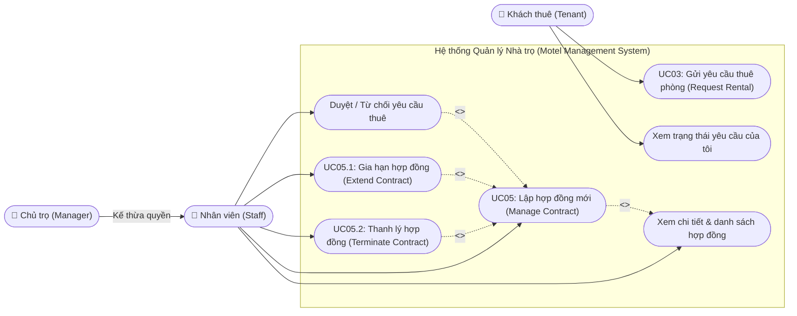
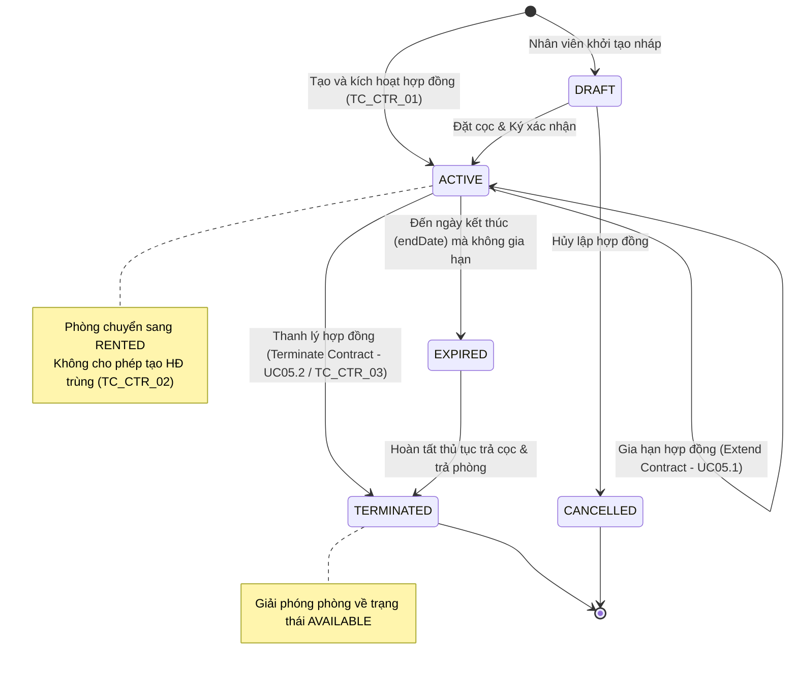
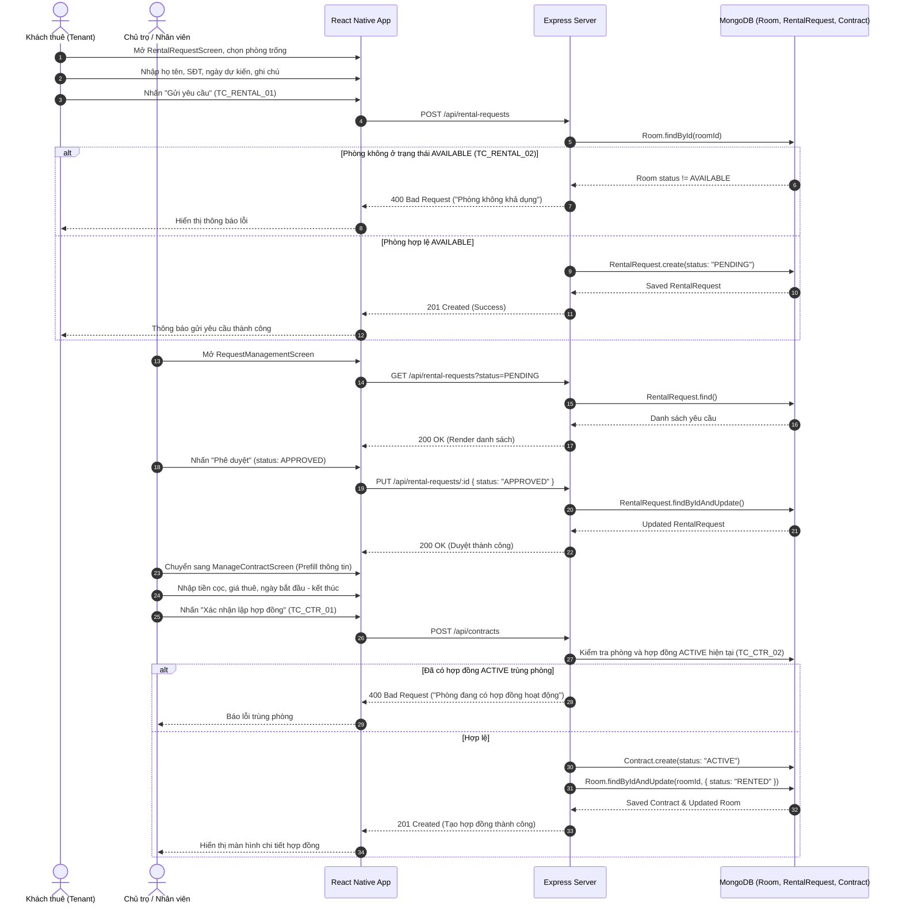
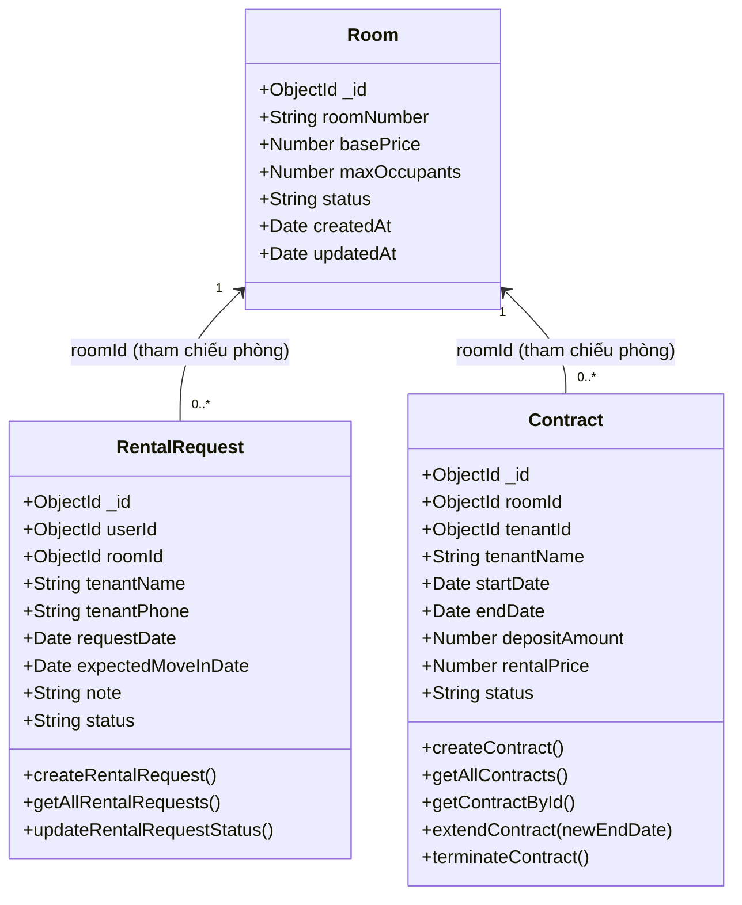

# TÀI LIỆU UML & ĐẶC TẢ PHÂN HỆ: RENTAL REQUEST & CONTRACT MANAGEMENT
**Dự án:** Motel Management System (Hệ thống Quản lý Nhà trọ Thông minh)  
**Môn học:** Software Design (SWD392) - FPT University  
**Phân hệ phụ trách:** Rental Request & Contract Management  

---

## 1. USE CASE DIAGRAM (Sơ đồ Use Case - Rental & Contract)

---

## 2. STATE MACHINE DIAGRAM (Sơ đồ trạng thái - Vòng đời Hợp đồng)

---

## 3. SEQUENCE DIAGRAM (Sơ đồ tuần tự - Quy trình Thuê phòng & Ký Hợp đồng)

---

## 4. CLASS DIAGRAM (Sơ đồ lớp phân hệ Rental & Contract)

---

## 5. BẢNG CHI TIẾT TEST CASES ĐẢM NHIỆM

| Test Case ID | Tên ca kiểm thử | Điều kiện tiên quyết & Dữ liệu đầu vào | Các bước thực hiện | Kết quả mong đợi |
| :--- | :--- | :--- | :--- | :--- |
| **TC_RENTAL_01** | Gửi yêu cầu thuê phòng thành công | Phòng `P101` có trạng thái `AVAILABLE`. Dữ liệu: `roomId`, `tenantName: "Nguyễn Văn A"`, `tenantPhone: "0901234567"`. | 1. Chọn phòng P101. 2. Nhập họ tên, SĐT. 3. Bấm Gửi yêu cầu. | Server trả về Status `201 Created`, bản ghi lưu vào `rentalRequests` với `status: 'PENDING'`. |
| **TC_RENTAL_02** | Không cho thuê phòng đã được đặt / đang thuê | Phòng `P102` có trạng thái `RENTED` hoặc `MAINTENANCE`. | 1. Gửi request thuê phòng P102. 2. Gọi API `POST /api/rental-requests`. | Server trả về Status `400 Bad Request`, thông báo "Phòng hiện tại không khả dụng để thuê". |
| **TC_CTR_01** | Tạo hợp đồng hợp lệ | Phòng `P101` đang `AVAILABLE`. Nhập `startDate: 2026-11-01`, `endDate: 2027-05-01`, `depositAmount: 3000000`, `rentalPrice: 3000000`. | 1. Điền form tạo HĐ. 2. Bấm Xác nhận lập hợp đồng. | Hợp đồng tạo thành công (`201 Created`), trạng thái phòng P101 tự động chuyển sang `RENTED`. |
| **TC_CTR_02** | Không cho tạo hợp đồng trùng phòng | Phòng `P101` đã ở trạng thái `RENTED` hoặc đã có hợp đồng `ACTIVE`. | 1. Cố ý gửi payload lập HĐ mới cho P101. 2. Gọi `POST /api/contracts`. | Server báo lỗi `400 Bad Request`, "Phòng đang có hợp đồng hoạt động hoặc đã được thuê". |
| **TC_CTR_03** | Thanh lý hợp đồng và giải phóng phòng | Hợp đồng đang `ACTIVE`, phòng liên kết đang `RENTED`. | 1. Vào chi tiết hợp đồng. 2. Nhấn "Thanh lý hợp đồng". 3. Gọi `PUT /api/contracts/:id/terminate`. | Hợp đồng chuyển sang `TERMINATED`, trạng thái phòng tự động đổi về `AVAILABLE` để đón khách mới. |

