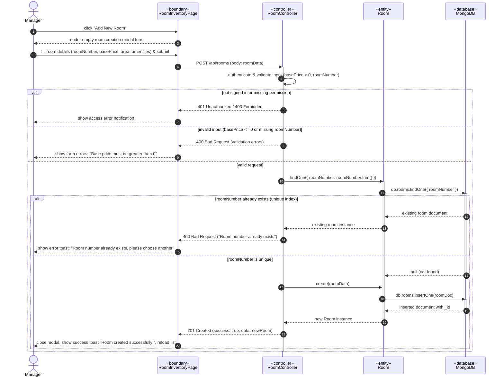
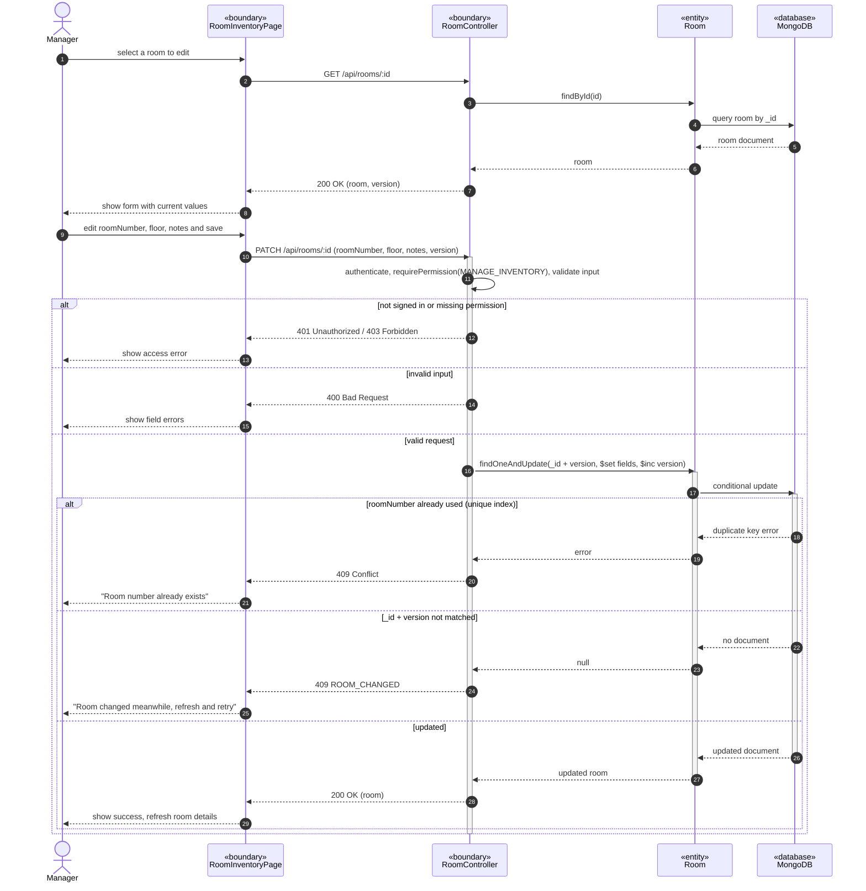
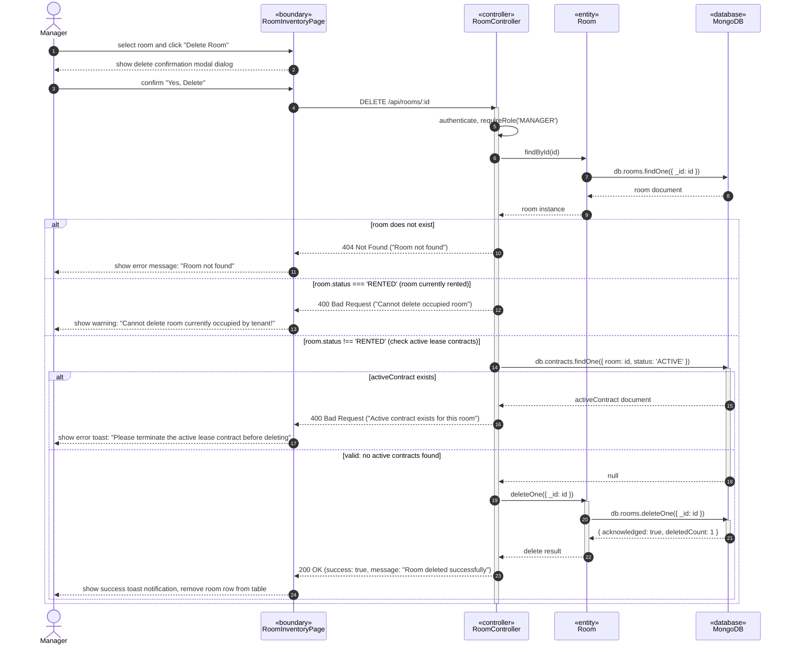
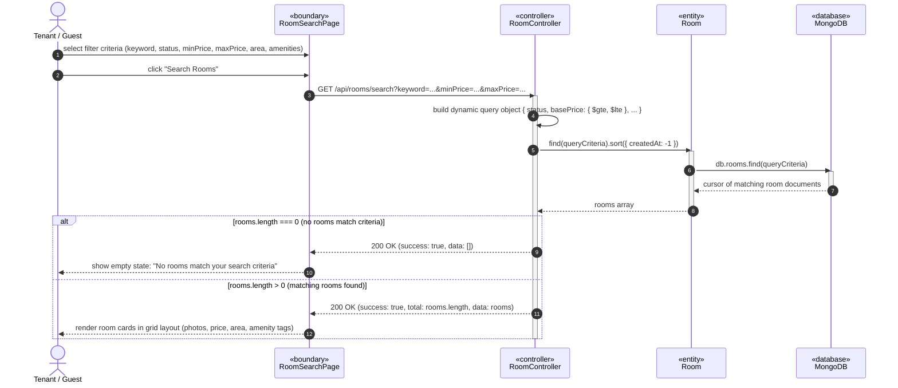
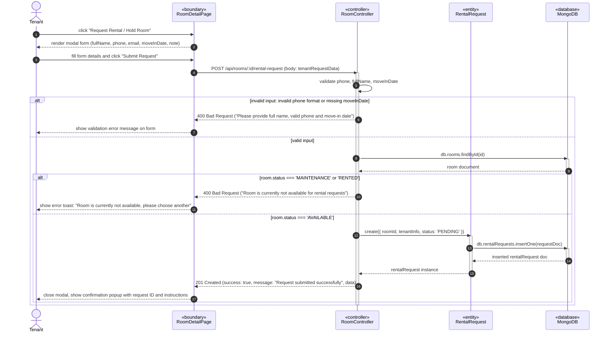

# UML DESIGN SPECIFICATION - ROOM MANAGEMENT MODULE (QUANG - LEADER)
**Course:** Software Design (SWD392) - FPT University  
**Project:** Motel Management System  
**Author:** Nguyen Ngoc Quang (Member 1 - Team Leader)  
**Assigned Module:** Room Management & Room Search (`Room`, `RentalRequest`)

---

## I. DIAGRAM FILES OVERVIEW

All diagrams are designed strictly following the **BCE (Boundary - Controller - Entity)** software engineering pattern, fully synchronized with the project's actual Backend (`backend/controllers/roomController.js`, `roomService.js`) and Frontend (`ManageRoomScreen.jsx`, `RoomSearchScreen.jsx`, `RoomDetailScreen.jsx`).

All `.drawio` files (100% in professional English, adhering to the teacher's approved standard `UC-M09_Update_Room_Info_SequenceDiagram.drawio`) are located at:
1. **Local Downloads folder:** `C:\Users\nguye\Downloads\`
2. **Project Docs folder:** `E:\02_Projects_BaiTap\ReactJS_FER202\LuyenReactJS\MotalManagementSystems\docs\diagrams\`

File list:
- 📊 **Class Diagram:** `ClassDiagram_Room_Module.drawio`
- 🔁 **Sequence Diagram UC-M04.1 (Create Room):** `UC-M04_1_Create_Room_SequenceDiagram.drawio`
- 🔁 **Sequence Diagram UC-M04.2 (Update Room):** `UC-M04_2_Update_Room_SequenceDiagram.drawio`
- 🔁 **Sequence Diagram UC-M04.3 (Delete Room):** `UC-M04_3_Delete_Room_SequenceDiagram.drawio`
- 🔁 **Sequence Diagram UC-M02 (Search & Filter Room):** `UC-M02_Search_Room_SequenceDiagram.drawio`
- 🔁 **Sequence Diagram UC-M03 (Request Rental / Hold Room):** `UC-M03_Request_Rental_SequenceDiagram.drawio`

---

## II. CLASS DIAGRAM - ROOM MODULE

```mermaid
classDiagram
    direction LR

    class RoomInventoryPage {
        <<boundary>>
        - rooms: Room[]
        - selectedRoom: Room
        - filterStatus: String
        - isModalOpen: Boolean
        + componentDidMount() void
        + loadRooms() void
        + handleCreateRoom(data: CreateRoomDTO) void
        + handleUpdateRoom(id: String, data: UpdateRoomDTO) void
        + handleDeleteRoom(id: String) void
        + render() JSX.Element
    }

    class RoomSearchPage {
        <<boundary>>
        - searchResults: Room[]
        - filterCriteria: RoomFilterDTO
        - loading: Boolean
        + handleSearch() void
        + handleFilterChange(field: String, val: Any) void
        + renderGridCards() JSX.Element
    }

    class RoomDetailPage {
        <<boundary>>
        - room: Room
        - requestModalOpen: Boolean
        + loadRoomDetails(id: String) void
        + submitRentalRequest(req: RentalRequestDTO) void
    }

    class RoomController {
        <<controller>>
        + getAllRooms(req: Request, res: Response) Promise~void~
        + searchRooms(req: Request, res: Response) Promise~void~
        + getRoomById(req: Request, res: Response) Promise~void~
        + createRoom(req: Request, res: Response) Promise~void~
        + updateRoom(req: Request, res: Response) Promise~void~
        + deleteRoom(req: Request, res: Response) Promise~void~
        + createRentalRequest(req: Request, res: Response) Promise~void~
    }

    class RoomService {
        <<service>>
        + fetchAllRooms() Promise~Room[]~
        + searchByCriteria(filter: RoomFilterDTO) Promise~Room[]~
        + findRoomById(id: String) Promise~Room~
        + createNewRoom(dto: CreateRoomDTO) Promise~Room~
        + updateRoomById(id: String, dto: UpdateRoomDTO) Promise~Room~
        + removeRoom(id: String) Promise~Boolean~
        + validateRoomNumberUnique(num: String) Promise~Boolean~
    }

    class Room {
        <<entity>>
        + _id: ObjectId
        + roomNumber: String
        + basePrice: Number
        + area: Number
        + maxOccupants: Number
        + amenities: String[]
        + status: RoomStatus
        + description: String
        + images: String[]
        + createdAt: Date
        + updatedAt: Date
        + isAvailable() Boolean
        + canBeDeleted() Boolean
    }

    class RentalRequest {
        <<entity>>
        + _id: ObjectId
        + roomId: ObjectId
        + tenantName: String
        + tenantPhone: String
        + tenantEmail: String
        + moveInDate: Date
        + note: String
        + status: RequestStatus
        + createdAt: Date
        + approve() void
        + reject(reason: String) void
    }

    class RoomStatus {
        <<enumeration>>
        AVAILABLE
        RENTED
        MAINTENANCE
    }

    class RequestStatus {
        <<enumeration>>
        PENDING
        APPROVED
        REJECTED
    }

    RoomInventoryPage ..> RoomController : HTTP REST
    RoomSearchPage ..> RoomController : HTTP REST
    RoomDetailPage ..> RoomController : HTTP REST
    RoomController ..> RoomService : delegates
    RoomService ..> Room : manages
    RoomService ..> RentalRequest : creates
    Room "1" -- "0..*" RentalRequest : receives
    Room ..> RoomStatus : has
    RentalRequest ..> RequestStatus : has
```

---

## III. SEQUENCE DIAGRAMS (100% ENGLISH)

### 1. UC-M04.1: Create Room
- **Actor:** `Manager`
- **Lifelines:** `Manager` $\rightarrow$ `«boundary» RoomInventoryPage` $\rightarrow$ `«controller» RoomController` $\rightarrow$ `«entity» Room` $\rightarrow$ `«database» MongoDB`

---

### 2. UC-M04.2: Update Room Information
*(Matches the teacher's approved sample `UC-M09_Update_Room_Info_SequenceDiagram.drawio`)*:

---

### 3. UC-M04.3: Delete Room
- **Key Business Constraint:** Prevents deletion if the room is currently occupied (`RENTED`) or associated with an active contract (`ACTIVE`).

---

### 4. UC-M02: Search & Filter Rooms
- **Actor:** `Tenant` / `Guest`

---

### 5. UC-M03: Request Rental / Hold Room
- **Actor:** `Tenant`

