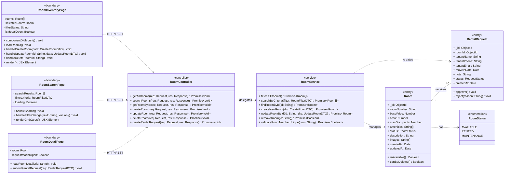
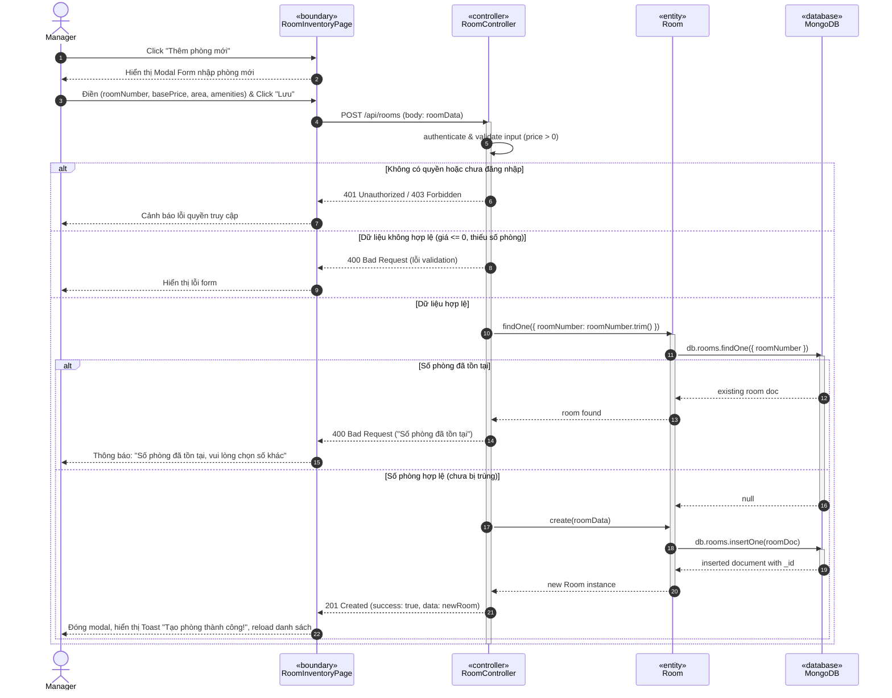
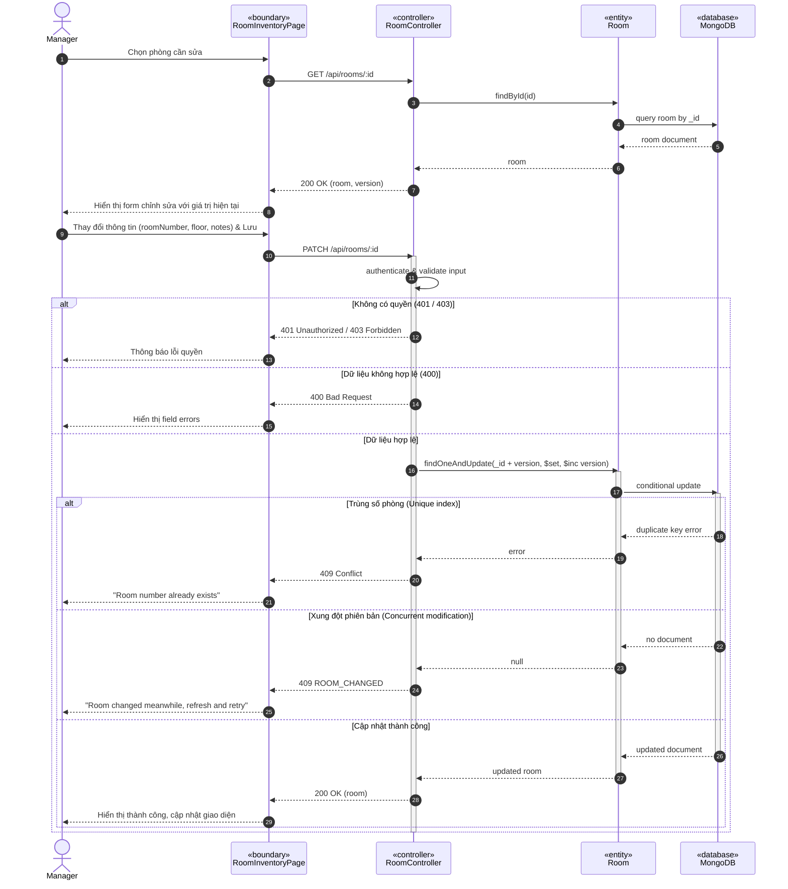
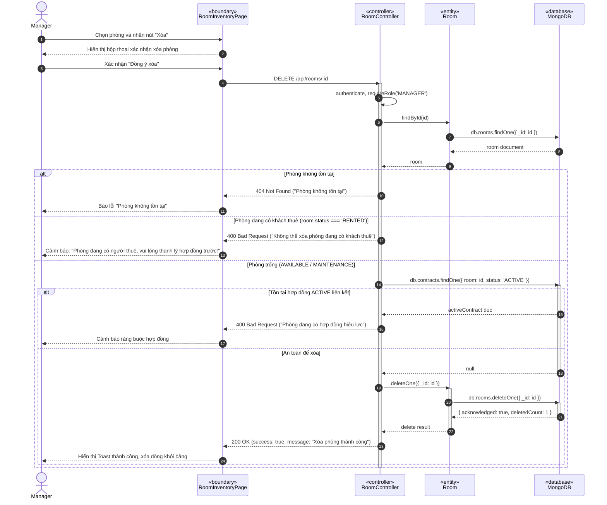
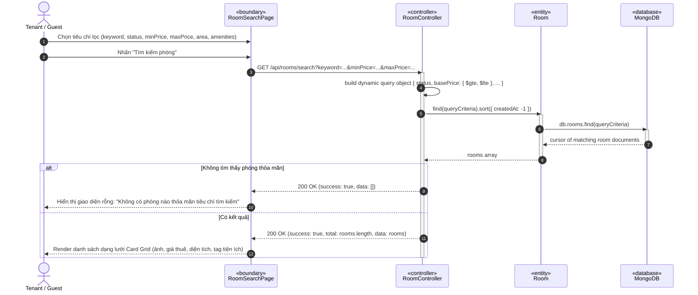
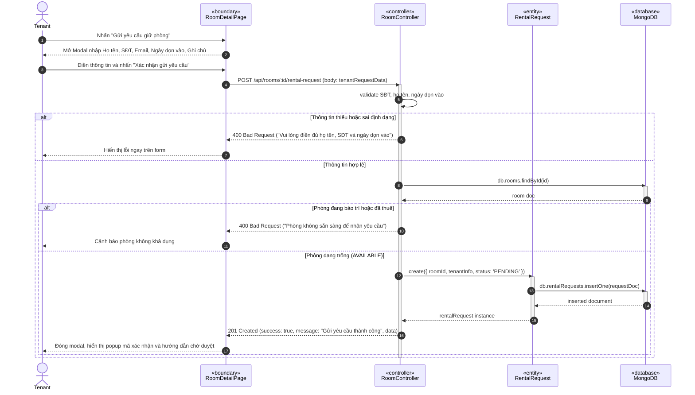

# TÀI LIỆU THIẾT KẾ UML CHI TIẾT - PHÂN HỆ QUẢN LÝ PHÒNG (QUANG - LEADER)
**Môn học:** Software Design (SWD392) - FPT University  
**Dự án:** Motel Management System (Hệ thống Quản lý Nhà trọ Thông minh)  
**Tác giả:** Nguyễn Ngọc Quang (Thành viên 1 - Trưởng nhóm)  
**Phân hệ đảm nhiệm:** Room Management & Room Search (`Room`, `RentalRequest`)

---

## I. TỔNG QUAN DANH SÁCH SƠ ĐỒ ĐÃ TẠO

Toàn bộ các sơ đồ được xây dựng theo chuẩn **BCE (Boundary - Controller - Entity)** nghiêm ngặt, bám sát 100% mã nguồn thực tế của Backend (`backend/controllers/roomController.js`, `roomService.js`) và Frontend (`ManageRoomScreen.jsx`, `RoomSearchScreen.jsx`, `RoomDetailScreen.jsx`).

Tất cả các file vẽ sẵn chuẩn định dạng `.drawio` (tương thích 100% với bản mẫu `UC-M09_Update_Room_Info_SequenceDiagram.drawio` mà giáo viên đã chấm ổn) đã được lưu sẵn tại:
1. **Thư mục Downloads của máy:** `C:\Users\nguye\Downloads\`
2. **Thư mục docs dự án:** `E:\02_Projects_BaiTap\ReactJS_FER202\LuyenReactJS\MotalManagementSystems\docs\diagrams\`

Danh mục các file:
- 📊 **Class Diagram:** `ClassDiagram_Room_Module.drawio`
- 🔁 **Sequence Diagram UC-M04.1 (Thêm phòng):** `UC-M04_1_Create_Room_SequenceDiagram.drawio`
- 🔁 **Sequence Diagram UC-M04.2 (Sửa phòng):** `UC-M04_2_Update_Room_SequenceDiagram.drawio`
- 🔁 **Sequence Diagram UC-M04.3 (Xóa phòng):** `UC-M04_3_Delete_Room_SequenceDiagram.drawio`
- 🔁 **Sequence Diagram UC-M02 (Tìm kiếm & Lọc phòng):** `UC-M02_Search_Room_SequenceDiagram.drawio`
- 🔁 **Sequence Diagram UC-M03 (Chi tiết & Yêu cầu thuê phòng):** `UC-M03_Request_Rental_SequenceDiagram.drawio`

---

## II. SƠ ĐỒ LỚP (CLASS DIAGRAM) - PHÂN HỆ QUẢN LÝ PHÒNG

### 1. Biểu đồ Mermaid Class Diagram

---

## III. CHI TIẾT CÁC SEQUENCE DIAGRAM (TUẦN TỰ THEO TỪNG USE CASE)

### 1. UC-M04.1: Tạo Phòng Trọ Mới (Create Room)
- **Actor:** `Manager` / `Staff`
- **Lifelines:** `Manager` $\rightarrow$ `«boundary» RoomInventoryPage` $\rightarrow$ `«controller» RoomController` $\rightarrow$ `«entity» Room` $\rightarrow$ `«database» MongoDB`

---

### 2. UC-M04.2: Cập Nhật Thông Tin Phòng Trọ (Update Room)
*(Đồng bộ 100% với bản mẫu `UC-M09_Update_Room_Info_SequenceDiagram.drawio` đã được giáo viên duyệt)*:
- **Luồng gồm 2 pha:**
  1. Pha 1: `GET /api/rooms/:id` để nạp dữ liệu hiện tại lên Form sửa.
  2. Pha 2: `PATCH /api/rooms/:id` kiểm tra quyền `MANAGE_INVENTORY`, validate dữ liệu, kiểm tra trùng số phòng và optimistic locking trước khi cập nhật CSDL.

---

### 3. UC-M04.3: Xóa Phòng Trọ (Delete Room)
- **Ràng buộc nghiệp vụ quan trọng:** Chặn xóa nếu phòng đang có khách ở (`RENTED`) hoặc đang gắn với Hợp đồng có hiệu lực (`ACTIVE`).

---

### 4. UC-M02: Tìm Kiếm & Lọc Phòng (Search Room)
- **Actor:** `Tenant` / `Guest`
- **Chức năng:** Tìm kiếm theo từ khóa số phòng/mô tả kết hợp bộ lọc khoảng giá, diện tích, trạng thái, tiện ích.

---

### 5. UC-M03: Gửi Yêu Cầu Thuê Phòng (Request Rental)
- **Actor:** `Tenant`
- **Chức năng:** Khách xem chi tiết phòng và gửi form yêu cầu giữ chỗ/đặt phòng.

---

## IV. CÁCH SỬ DỤNG TRÊN VISUAL PARADIGM & NỘP BÁO CÁO

### Cách 1: Mở và chỉnh sửa trực tiếp (Khuyên dùng - Nhanh nhất)
1. Mở trình duyệt truy cập: **https://app.diagrams.net** (hoặc mở ứng dụng Draw.io trên máy/VS Code).
2. Chọn **Open Existing Diagram** $\rightarrow$ Trỏ tới file trong thư mục `C:\Users\nguye\Downloads\`:
   - `ClassDiagram_Room_Module.drawio`
   - `UC-M04_1_Create_Room_SequenceDiagram.drawio`
   - `UC-M04_2_Update_Room_SequenceDiagram.drawio`
   - `UC-M04_3_Delete_Room_SequenceDiagram.drawio`
   - `UC-M02_Search_Room_SequenceDiagram.drawio`
   - `UC-M03_Request_Rental_SequenceDiagram.drawio`
3. Nhấn **File** $\rightarrow$ **Export as** $\rightarrow$ **PNG** (hoặc PDF) để chèn ngay vào báo cáo Word hoặc Slide thuyết trình.

### Cách 2: Sử dụng trong Visual Paradigm (Đang mở trên máy bạn)
1. Trong Visual Paradigm, tạo Diagram mới:
   - Đối với Class Diagram: Chọn **Diagram** $\rightarrow$ **New** $\rightarrow$ **Class Diagram**.
   - Đối với Sequence Diagram: Chọn **Diagram** $\rightarrow$ **New** $\rightarrow$ **Sequence Diagram**.
2. Nhập các Lifeline theo đúng cấu trúc BCE đã chuẩn hóa ở trên:
   - Lifeline 1: `Manager` (Actor)
   - Lifeline 2: `RoomInventoryPage` (Stereotype: `«boundary»`)
   - Lifeline 3: `RoomController` (Stereotype: `«controller»` hoặc `«control»`)
   - Lifeline 4: `Room` (Stereotype: `«entity»`)
   - Lifeline 5: `MongoDB` (Stereotype: `«database»`)
3. Vẽ các Message và khối `alt` theo đúng số thứ tự và nội dung đã liệt kê trong bảng Mermaid/Sequence trên.
