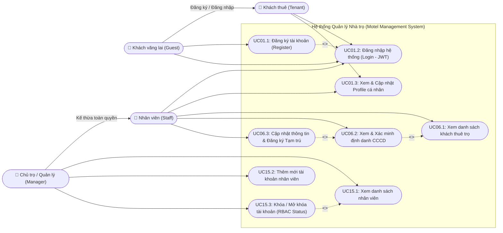
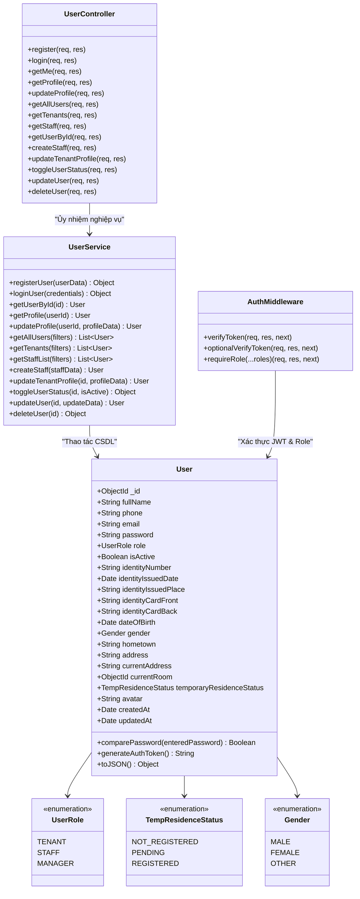
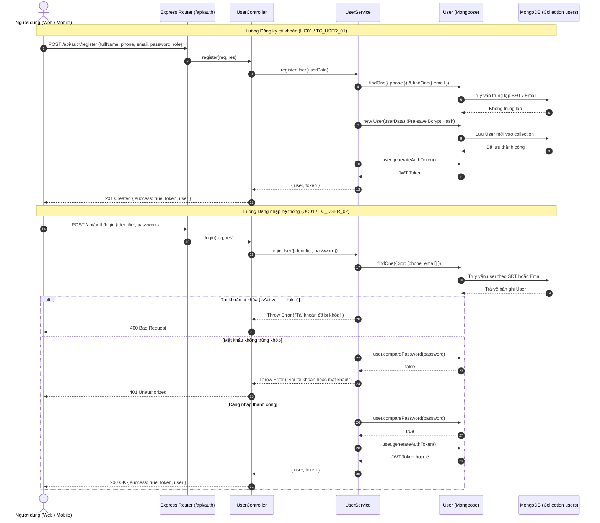
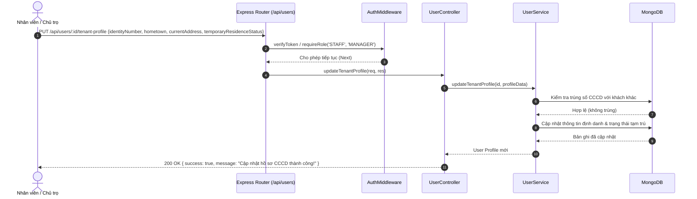

# TÀI LIỆU UML & ĐẶC TẢ PHÂN HỆ: USER AUTHENTICATION & TENANT MANAGEMENT
**Dự án:** Motel Management System (Hệ thống Quản lý Nhà trọ Thông minh)  
**Môn học:** Software Design (SWD392) - FPT University  
**Phân hệ phụ trách:** User Authentication & Tenant Management (Xác thực Người dùng & Quản lý Khách thuê)  

---

## 1. USE CASE DIAGRAM (Sơ đồ Use Case - Account & Tenant)

---

## 2. CLASS DIAGRAM (Sơ đồ Lớp - User & Các vai trò)

---

## 3. SEQUENCE DIAGRAMS (Sơ đồ tuần tự xử lý)

### 3.1. Đăng ký & Đăng nhập hệ thống (UC01 / TC_USER_01, TC_USER_02)

### 3.2. Quản lý Khách thuê & Cập nhật Hồ sơ CCCD (UC06 / TC_USER_03)

---

## 4. BẢNG ĐẶC TẢ CƠ SỞ DỮ LIỆU (Database Schema: `users`)

| Tên Trường | Kiểu Dữ Liệu | Ràng Buộc (Constraints) | Mô Tả Nghiệp Vụ |
| :--- | :--- | :--- | :--- |
| `_id` | ObjectId | Primary Key, Auto Generated | Mã định danh duy nhất của người dùng |
| `fullName` | String | Required, Trim | Họ và tên đầy đủ |
| `phone` | String | Required, Unique, Regex `^[0-9]{9,11}$` | Số điện thoại đăng nhập & liên lạc |
| `email` | String | Required, Unique, Lowercase | Email cá nhân nhận thông báo |
| `password` | String | Required, Min length: 6, Bcrypt | Mật khẩu tài khoản (đã được băm an toàn) |
| `role` | String | Enum: `['TENANT', 'STAFF', 'MANAGER']` | Phân quyền vai trò trong hệ thống |
| `isActive` | Boolean | Default: `true` | Trạng thái kích hoạt (false = bị khóa) |
| `identityNumber` | String | Sparse, Unique, Regex `^[0-9]{9,12}$` | Số CCCD / Hộ chiếu định danh |
| `identityIssuedDate` | Date | Optional | Ngày cấp CCCD |
| `identityIssuedPlace`| String | Default: 'Cục Cảnh sát QLHC về TTXH' | Nơi cấp CCCD |
| `identityCardFront` | String | URL String | Đường dẫn ảnh mặt trước thẻ CCCD |
| `identityCardBack`  | String | URL String | Đường dẫn ảnh mặt sau thẻ CCCD |
| `address` | String | Trim, Default: '' | Địa chỉ thường trú của khách |
| `currentAddress` | String | Trim, Default: '' | Nơi ở hiện tại trước khi thuê |
| `hometown` | String | Trim, Default: '' | Quê quán nguyên quán |
| `gender` | String | Enum: `['MALE', 'FEMALE', 'OTHER']` | Giới tính |
| `temporaryResidenceStatus` | String | Enum: `['NOT_REGISTERED', 'PENDING', 'REGISTERED']` | Trạng thái đăng ký tạm trú với Công an |
| `currentRoom` | ObjectId | Ref: `'Room'`, Default: `null` | Phòng đang thuê hiện tại (nếu có) |
| `avatar` | String | URL String | Đường dẫn ảnh đại diện |
| `createdAt` | Date | Timestamps | Ngày tạo tài khoản |
| `updatedAt` | Date | Timestamps | Ngày cập nhật gần nhất |

---

## 5. Ý NGHĨA NGHIỆP VỤ THỰC TẾ CỦA PROFILESCREEN

Khách thuê bắt buộc phải có màn hình **`ProfileScreen`** để giải quyết 3 bài toán nghiệp vụ cốt lõi:

1. **Hoàn thiện hồ sơ định danh pháp lý:**
   - Cập nhật **Số CCCD (12 chữ số)**, ngày cấp, nơi cấp.
   - Cập nhật **Quê quán / Địa chỉ thường trú**.
   - Tải lên ảnh chụp 2 mặt của thẻ CCCD để chủ trọ khai báo tạm trú với Công an khu vực theo Luật Cư trú.
2. **Quản lý thông tin liên lạc & tài khoản:**
   - Cập nhật **Số điện thoại** hoặc **Email** để nhận thông báo tiền phòng, hóa đơn hàng tháng.
   - **Đổi mật khẩu** tài khoản khi cần bảo mật.
3. **Phục vụ tự động điền (Auto-fill):**
   - Khi khách đã cập nhật đầy đủ CCCD trong Profile, khi sang phân hệ của Quang để bấm *"Gửi yêu cầu thuê phòng"*, hệ thống sẽ tự động lấy thông tin từ Profile sang, khách không cần gõ lại từ đầu.

---

## 6. MA TRẬN TEST CASES (Test Matrix)

| Mã Test Case | Tên Kiểm Thử | Dữ Liệu Đầu Vào | Kết Quả Mong Đợi | Trạng Thái |
| :--- | :--- | :--- | :--- | :---: |
| **TC_USER_01** | Đăng ký tài khoản hợp lệ | Họ tên, SĐT, Email, Password hợp lệ | Tạo thành công, mật khẩu Bcrypt băm an toàn, sinh JWT Token | **PASS ✅** |
| **TC_USER_02** | Đăng nhập sai & đúng mật khẩu | Sai password $\rightarrow$ Đúng password | Báo lỗi 401 khi sai mật khẩu; Trả về token khi đúng mật khẩu | **PASS ✅** |
| **TC_USER_03** | Cập nhật hồ sơ cá nhân & CCCD | CCCD 12 số, địa chỉ, quê quán | Cập nhật thành công; Chặn báo lỗi khi gán trùng số CCCD người khác | **PASS ✅** |
| **TC_USER_04** | Kiểm tra phân quyền & Khóa tài khoản | Role `TENANT` gọi quyền Manager; Khóa `isActive = false` | Chặn 403 Forbidden đúng quyền; Chặn đăng nhập khi tài khoản bị khóa | **PASS ✅** |
