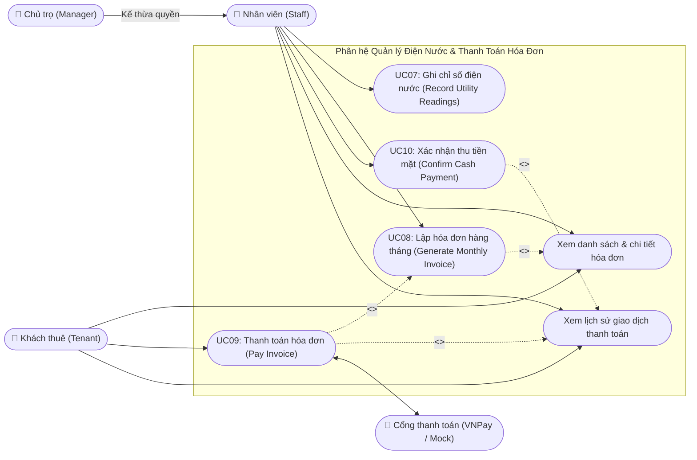
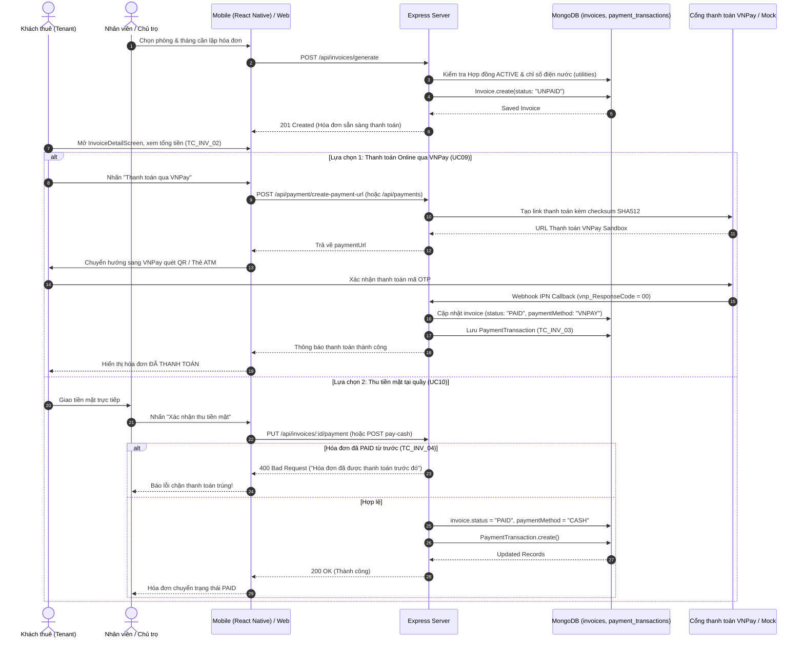
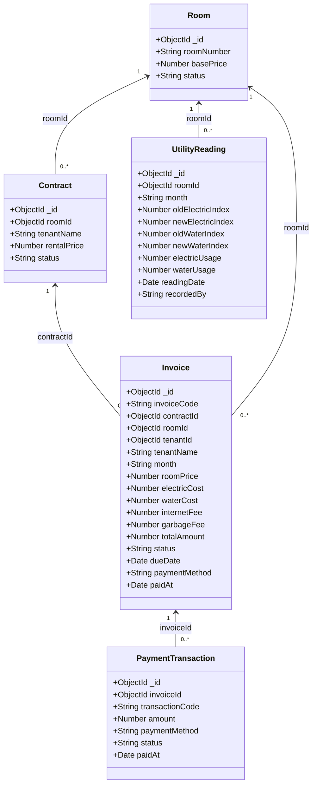

# TÀI LIỆU THIẾT KẾ UML & ĐẶC TẢ PHÂN HỆ: UTILITY, INVOICE & PAYMENT MANAGEMENT
**Dự án:** Motel Management System (Hệ thống Quản lý Nhà trọ Thông minh)  
**Môn học:** Software Design (SWD392) - FPT University  
**Phụ trách:** Thành viên 4 – Nguyễn Văn Mạnh  
**Phân hệ:** Utility, Billing & Payment Management  

---

## 1. USE CASE DIAGRAM – UTILITY, INVOICE & PAYMENT

---

## 2. SEQUENCE DIAGRAM – QUY TRÌNH THANH TOÁN HÓA ĐƠN (PAY INVOICE SEQUENCE)

---

## 3. CLASS DIAGRAM – THỰC THỂ CƠ SỞ DỮ LIỆU (MONGODB COLLECTIONS)

---

## 4. BẢNG TEST CASES CHI TIẾT THEO YÊU CẦU

| Test Case ID | Tên ca kiểm thử | Mô tả & Dữ liệu đầu vào | Kết quả mong đợi | Trạng thái thực tế |
| :--- | :--- | :--- | :--- | :---: |
| **TC_INV_01** | Chỉ số điện nước mới nhỏ hơn chỉ số cũ | Nhập số điện cũ: 100, mới: 80 | Hệ thống báo lỗi: "Chỉ số điện mới không được nhỏ hơn chỉ số cũ", từ chối lưu. | **PASS ✅** |
| **TC_INV_02** | Tính tổng hóa đơn chính xác | Tiền phòng: 2.000.000, Điện: 50 kWh * 3500 = 175.000, Nước: 5 m³ * 20.000 = 100.000 | Tổng tiền hóa đơn tự tính chính xác: 2.275.000 VNĐ. | **PASS ✅** |
| **TC_INV_03** | Thanh toán hóa đơn thành công | Khách thanh toán hóa đơn UNPAID qua VNPay / Tiền mặt | Hóa đơn đổi sang `PAID`, giao dịch được lưu vào `payment_transactions` trên MongoDB. | **PASS ✅** |
| **TC_INV_04** | Không thanh toán trùng hóa đơn | Cố ý gửi yêu cầu thanh toán lần 2 cho hóa đơn đã `PAID` | Hệ thống chặn lại, báo lỗi "Hóa đơn này đã được thanh toán trước đó!". | **PASS ✅** |
